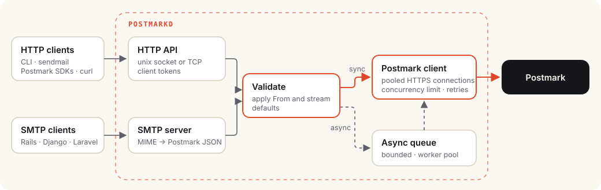

# How it works

postmarkd is a single Go program with no third-party dependencies. This page
follows a message through it and explains the design decisions that matter
when you run it.

## Overview

| Component | Package | Responsibility |
| --- | --- | --- |
| HTTP API | `internal/server` | Postmark-compatible endpoints, auth, validation, defaults, async dispatch, health and metrics |
| SMTP server | `internal/smtpd` | A minimal ESMTP server (PIPELINING, SIZE, 8BITMIME, AUTH) |
| MIME converter | `internal/rfc822` | Raw messages → Postmark JSON, for SMTP and `sendmail` |
| Postmark client | `internal/postmark` | Connection pooling, the concurrency limit, retries |
| Queue | `internal/queue` | Bounded in-memory queue and worker pool for async sends |
| Blackhole | `internal/blackhole` | A stand-in for Postmark in blackhole mode |
| systemd | `internal/systemd` | Socket activation, readiness, watchdog |
| Metrics | `internal/metrics` | Lock-free counters and Prometheus output |

## The life of a message

### 1. Arrival

A message arrives over one of four paths:

- **HTTP**, on a unix socket or TCP port, at a Postmark-compatible endpoint.
- **SMTP.** The SMTP server collects the envelope and data, and the MIME
  converter turns the message into Postmark JSON.
- **sendmail.** The `sendmail` command converts the message on the client
  side and posts it over HTTP.
- **CLI.** `postmarkd send` builds the JSON and posts it over HTTP.

Everything after this point is shared.

### 2. Authentication

If `POSTMARKD_AUTH_TOKENS` is set, the request must carry one of the tokens,
compared in constant time. SMTP clients authenticate with `AUTH PLAIN` or
`AUTH LOGIN`, except on unix sockets, where file permissions already control
access.

### 3. Validation and defaults

postmarkd reads each message once, looking only at the fields it checks:
`From`, `To`/`Cc`/`Bcc`, `HtmlBody`/`TextBody`, `TemplateId`/`TemplateAlias`
and `MessageStream`. It doesn't copy them. If the message has no `From` or
stream, the configured default is inserted. Otherwise **the original bytes
are forwarded untouched**, so fields postmarkd doesn't know about, including
ones Postmark adds in the future, reach Postmark unchanged.

Messages with no sender, no recipient, no body (or template), or batches
that are empty or larger than 500 are rejected with a Postmark-style `422`
before any network call. This matters most for async sends, whose callers
would otherwise never see the error.

### 4. Synchronous or async

**Synchronous** (the default): the request waits for Postmark and returns
Postmark's response unchanged, so callers see real `MessageID`s and errors.

**Async** (`?async=true` or `X-Postmarkd-Async: true`): the prepared request
is placed on a bounded in-memory queue and the caller gets `202 Accepted`
immediately. `POSTMARKD_WORKERS` goroutines deliver queued requests. When the
queue is full the caller gets `503` with `Retry-After`. That back-pressure
keeps memory bounded under any load.

### 5. Sending to Postmark

All sends share one HTTP client with keep-alive connections to
`api.postmarkapp.com` (HTTP/2 when available). A semaphore caps in-flight
requests at `POSTMARKD_MAX_CONCURRENCY`; requests beyond that wait for a slot
instead of failing. This is both the throughput knob and the protection
against overwhelming Postmark.

### 6. Retries

postmarkd retries only when Postmark **cannot** have accepted the message:

| Failure | Retried? | Why |
| --- | --- | --- |
| DNS failure, connection refused, dial timeout | Yes | The request never left the host. |
| `429 Too Many Requests` | Yes, honouring `Retry-After` | Postmark refused it. |
| `502`, `503` | Yes | A proxy or maintenance page answered, not Postmark's API. |
| `500`, timeouts after sending | No | The message may already be sent. |
| `4xx` validation errors | No | Retrying won't help. |

Backoff is exponential with jitter (about 250 ms, 500 ms, 1 s, … capped at
10 s), up to `POSTMARKD_MAX_RETRIES` times. Duplicate mail is worse than a
reported failure, so ambiguous failures go back to the caller.

### 7. The response

HTTP callers get Postmark's status and body unchanged. SMTP clients get `250`
when Postmark accepted the message, `451` (try again later) when Postmark was
unreachable or rate limiting, and `554` when it rejected the message. The
`sendmail` command exits with the matching `sysexits.h` code.

Every outcome is counted in metrics and failures are logged with the request
ID, which callers can supply in `X-Request-Id`.

## Lifecycle

**Startup.** postmarkd loads and validates configuration (defaults, then the
config file, then the environment), takes listening sockets from systemd if
it was socket activated or binds its own, then reports `READY=1` to systemd
and starts the watchdog.

**Shutdown.** On `SIGTERM` or `SIGINT` it reports `STOPPING=1`, flips
`/readyz` to `503`, stops accepting connections, lets in-flight HTTP and SMTP
requests finish, and drains the async queue, all within
`POSTMARKD_SHUTDOWN_TIMEOUT`. Queued requests still undelivered when the time
runs out are logged and counted as dropped.

## Design choices

- **No dependencies.** Only the Go standard library, so the binary is small,
  static and easy to audit.
- **Postmark's API, not a new one.** Existing knowledge, documentation and
  SDKs apply, and postmarkd forwards fields it doesn't know about.
- **Never duplicate mail.** Retries only when delivery provably didn't
  happen.
- **Bounded everything.** Request bodies, the queue, concurrency and
  timeouts all have limits, so overload turns into back-pressure, not memory
  growth.
- **The token in one place.** Applications never see the Postmark server
  token. systemd credentials keep it out of files and environment variables.

## Limits

- The async queue is in memory: a crash or `SIGKILL` loses queued mail.
  Use synchronous sends when every message must be confirmed.
- SMTP has no STARTTLS: use it on loopback, unix sockets or private networks.
- Up to 50 recipients per message and 500 messages per batch, as in Postmark.

See [Benchmarks](benchmarks.md) for how fast each stage is.
